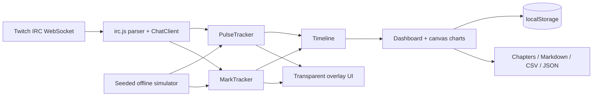

# StreamPulse

StreamPulse is a zero-install Twitch chat overlay and streamer dashboard. It watches anonymous, read-only Twitch IRC traffic in the browser, detects sudden community reactions and `!mark` / `!clip` choruses, then turns those moments into timestamps, YouTube chapters, a Markdown recap, CSV, and a restorable JSON session.

It is built for small and mid-size streamers who need to find the good parts of a long VOD without paying for an editor or trusting a clipping backend.

## 60-second quickstart

Requirements: Node.js 18+ for tests and Python 3 (or any static file server) for local use.

```bash
python3 -m http.server 8000
```

1. Open `http://localhost:8000`.
2. Enter a Twitch channel login.
3. Open the dashboard, or copy the generated overlay URL into OBS.

No package install or build step is needed. For a fully offline preview, open `http://localhost:8000/demo.html`.

## OBS setup

1. On the home page, enter the Twitch channel and choose the overlay settings.
2. Copy the OBS Browser Source URL.
3. In OBS, add a **Browser** source and paste the URL.
4. Set width to `1920` and height to `1080`. Leave custom CSS empty; the overlay background is already transparent.
5. Open the matching dashboard URL in a normal browser during the stream.

The overlay connects directly to `wss://irc-ws.chat.twitch.tv:443` as an anonymous `justinfan` user. It cannot send messages or perform moderation actions.

## URL parameters

| Parameter | Pages | Values | Default |
| --- | --- | --- | --- |
| `channel` | overlay, dashboard | Twitch login | required for live mode |
| `sensitivity` | overlay, dashboard | `1`–`10`; higher detects smaller spikes | `5` |
| `marks` | overlay, dashboard | unique chatters required for `!mark` / `!clip` | `3` |
| `theme` | overlay | `neon`, `clean` | `neon` |
| `corner` | overlay | `tl`, `tr`, `bl`, `br` | `br` |
| `rain` | overlay | `1`, `0` | `1` |
| `demo` | overlay, dashboard | `1` enables synthetic chat | off |
| `start` | dashboard | ISO timestamp or epoch milliseconds | connection time |

Examples:

```text
overlay.html?channel=twitch&theme=clean&corner=bl&rain=0
dashboard.html?channel=twitch&sensitivity=7&marks=4
dashboard.html?demo=1
```

## Detection model

Messages are counted in five-second buckets. StreamPulse maintains an exponentially weighted moving average baseline with `alpha = 0.15` and estimates robust spread from the median absolute deviation of roughly the last three minutes:

```text
spread = max(MAD(bucket counts) * 1.4826, 1.5)
score  = (current bucket - EWMA baseline) / spread
threshold(sensitivity) = 5.5 - 0.4 * sensitivity
```

An automatic moment requires a score above the threshold, at least six messages, at least three unique chatters, and no automatic moment in the previous 20 seconds. Labels prefer a dominant Twitch emote, then mostly-uppercase chat, then a repeated word, with `chat exploded` as the fallback.

A community moment fires when the configured number of unique users type `!mark` or `!clip` within 15 seconds. One user gets one vote per window, with a 30-second cooldown. Automatic and community moments within 15 seconds merge into one `both` moment.

## Privacy

Everything runs in the browser. There is no StreamPulse server, account, token, database, analytics script, runtime AI call, or telemetry. Live chat is received through Twitch's anonymous read-only IRC WebSocket connection. Session state is stored only in the browser's `localStorage` and in files the user explicitly exports.

Privacy mode is on by default. Exports include aggregate counts rather than usernames. Twitch emote images are loaded directly from Twitch's public CDN in live overlay mode; the synthetic demo uses local text badges and works offline.

## Architecture



Pure modules under `js/` have no DOM access and are shared by the browser UI and Node test suite. All pages use native ES modules, Canvas 2D, WebSocket, and browser storage APIs. There are zero runtime and zero development dependencies.

## Testing

```bash
node --test
```

The suite covers IRC parsing and Twitch tag escapes, emote ranges, reconnect backoff, pulse detection and labeling, mark windows and de-duplication, timeline merging and re-timing, all export formats and CSV formula-injection protection, and simulator determinism.

## Limitations

- Anonymous Twitch clients can read chat but cannot send chat messages.
- Only Twitch-native emotes included in IRC tags are rendered; third-party emotes are not resolved.
- Twitch may rate-limit anonymous connections, and chat availability follows Twitch's service behavior.
- Browser autoplay, storage, clipboard, and download policies vary; export downloads require a user click.
- StreamPulse identifies moments and timestamps but does not create video clips.

## License

[MIT](LICENSE)
